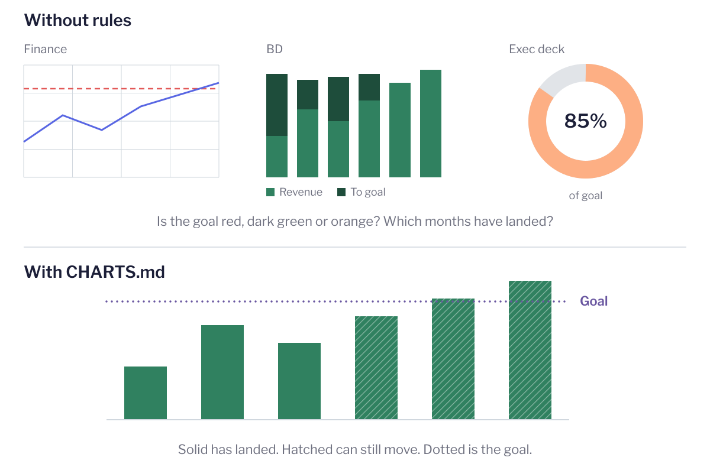

<h1>
  <picture>
    <source media="(prefers-color-scheme: dark)" srcset="assets/logo-dark.svg">
    
  </picture>
</h1>

Everyone at your company can make a dashboard now. Graphics Desk is the editor.

It's one file, [`CHARTS.md`](CHARTS.md), that tells the AI agent building your charts what every mark means: which color is money, which line is a target, what a dashed line promises. The agent reads it before it draws a chart and again before anyone sees it. So this week's dashboard agrees with last quarter's, and the CFO's screenshot agrees with yours.

Here's one number, revenue against goal, drawn by three teams without the file, then once with it:

<picture>
  <source media="(prefers-color-scheme: dark)" srcset="assets/before-after-dark.svg">
  
</picture>

Background: [Everyone at your company can make a dashboard now. Who's the editor?](https://jared.uno)

## How it works

On a newspaper graphics desk, an editor sits down with you before anything goes to press. They do a naive read of your chart and tell you what's clear and what isn't. They know the rules that keep every chart in the paper speaking the same language: red is always behind, a dotted line is always a target. Every chart can be right and the set can still be wrong. The editor's job is the set.

Most companies never had that desk. Now that anyone can ask Claude for a dashboard, they need one. `CHARTS.md` is the desk, written down, and your agent applies it twice:

1. **When a chart is built.** The agent starts from the rules instead of from whatever color is next in the palette.
2. **When it's reviewed.** The agent does the naive read and checks every mark against the file before the chart goes out.

The rule behind the bottom of that figure:

> Line style says whether a number has landed. **Solid** is measured and final. **Long dash** on a line, or **hatching** on a bar, is not settled: the future, or a number that can still move. **Dotted** is a marker: a pace, average, target or reference point. Computed, never measured.

## What's inside

`CHARTS.md` has two parts.

**Part 1: The rules.** These should hold anywhere.

- **Principles:** nine ideas to reason from when no rule covers the case, like "each channel answers one question" and "draw each value once."
- **Data or chrome:** which marks the rules govern. A bill is overdue whether or not anyone opened the ledger, so its pill is data.
- **Color:** hue families (green is money, blue is real, purple is a goal, red is a loss, yellow says look, gray is projected, amber is the model), two tiers of color tokens, and why entities get labels, not colors.
- **Line style:** solid, long dash and hatching, dotted and faded, and what each one promises.
- **Numbers and dates:** compact money, ASCII negatives, tabular figures, one shared set of formatters.
- **Anatomy of a chart card:** eyebrow, title, subtitle, controls, chart, legend, insight, always in that order.
- **Tables:** when the reader needs the values, not the shape.
- **Layout:** mobile first, and a panel you can't see collapses instead of leaving a hole.

**Part 2: Company-specific meanings.** The color meanings, values and thresholds for your own numbers. It ships filled in with a worked example from Upstatement's internal finance dashboards, covering revenue, net income, a weighted pipeline, project health and utilization. Keep what fits, delete what doesn't and add what your numbers need.

## Use it today

**1. Copy the file to the root of your repo.**

```bash
curl -O https://raw.githubusercontent.com/jarednova/graphics-desk/main/CHARTS.md
```

**2. Make Part 2 yours.** Rewrite the Meanings table for your own numbers and point each meaning at a color your project already has. Keep Part 1 as it is unless you disagree with it, and if you do, write down why.

**3. Point your agent at it.** Add this to `CLAUDE.md` (or `AGENTS.md`):

```markdown
## Charts

Before you build or change a chart, stat, KPI tile, legend or data table, read CHARTS.md and follow it. Use its meanings, never raw colors. If a chart needs a meaning that CHARTS.md doesn't have, stop and ask before adding one.
```

**4. Review before you share.** When a chart is done, ask for the naive read:

```text
Read CHARTS.md in full, then review the charts in this change against it. Sort what you find into three lists:

- Fix: a rule is broken, and something that already exists fixes it. Name the exact fix.
- Ask: fixing it needs a decision CHARTS.md doesn't make, like a mark that needs a meaning no token carries. Give 2–3 options and don't pick one.
- Departures: a judgment rule isn't followed, and the code shows why. Cite the reason.

Edit nothing.
```

The **Ask** list is the important one. A fix that invents a new color meaning changes the rulebook, so it should go to a person, not get applied quietly.

## Install it for your whole org

The steps above work one repo at a time. To give everyone at your company the same desk, including people who make dashboards in Claude and never open a repo, install Graphics Desk as a Claude skill. [`skill/SKILL.md`](skill/SKILL.md) tells Claude to read `CHARTS.md` before it draws a chart, stat, KPI tile, legend or table, and to do the naive read before it hands the work over. It also maps the defaults of Claude's Dashboard type onto `CHARTS.md`: the type's eight series colors don't get handed out to clients or teams, and its ok, warn and bad colors become your success, watch and loss meanings.

It ships as a skill, not a design system, because Claude's design systems apply to Slides and Design, and the Dashboard type doesn't read one.

**1. Make Part 2 yours** in your copy of `CHARTS.md`, as in "Use it today" above. The skill carries the file with it.

**2. Build the zip.** `CHARTS.md` stays at the root of this repo, and the script copies it in beside `SKILL.md`, so there's one copy to edit:

```bash
sh skill/build.sh
```

That writes `dist/graphics-desk.zip`, which holds a `graphics-desk/` folder with `SKILL.md` and `CHARTS.md` inside.

**3. Upload it.** An Owner of a Team or Enterprise org (not an Admin) uploads the zip under **Organization settings → Skills**. On Enterprise, turn on Skills first, along with code execution and file creation, which skills need. The skill is then on for every member, who sees it in their own Skills list with a team indicator and can turn it off.

**4. It follows people into Claude Code.** Members signed in to Claude Code with their Claude account (v2.1.273 or later, not an API key or Bedrock) get the skill at the start of each session, listed under "claude.ai sync" in `/skills`. In a repo that has its own `CHARTS.md` at the root, the skill reads that copy instead of the one it carries.

**5. Test it in Dashboards.** Nobody has confirmed yet that a skill fires reliably inside Claude's Dashboards flow. After you upload it, ask Claude for a dashboard of monthly revenue by client, then check that it says it's using graphics-desk, that clients are labeled rather than colored, and that the open month is hatched. If it skips the skill, name it in the request ("use the graphics-desk skill") and [open an issue](https://github.com/jarednova/graphics-desk/issues) so this step can say what works.

When `CHARTS.md` changes, build the zip again and re-upload it.

## Where this is going

The skill above does both jobs: it reads `CHARTS.md` before a chart gets built and does the naive read before it ships. The next step is making sure it fires every time, in Dashboards and in code. I'm also writing up the rules one at a time on [jared.uno](https://jared.uno).

`CHARTS.md` is a working copy. It changes as I use it, and the date at the top says when it last did.

## License

[CC BY 4.0](LICENSE). Copy it, adapt it and ship it in your own repo. Just credit Jared Novack and link back here.
